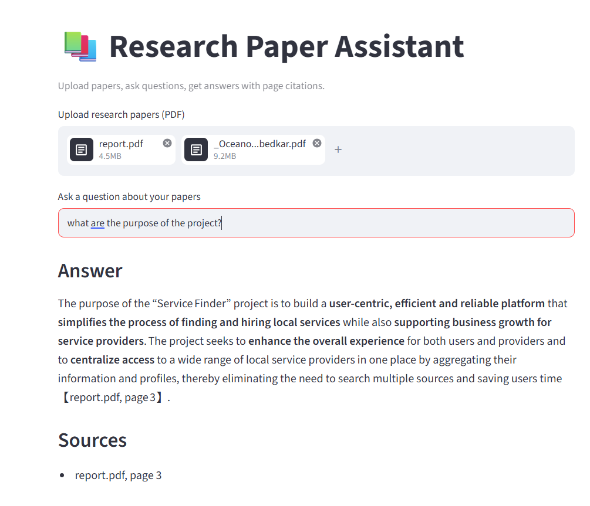
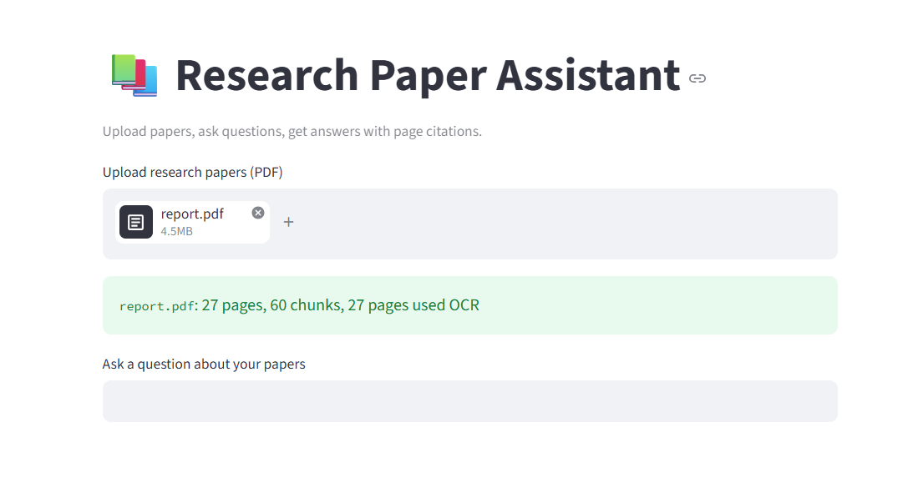

# Research Paper Assistant (RAG + OCR)

A web app that answers questions about uploaded PDFs, including scanned ones, and cites the file and page for every answer. If the documents don't contain the answer, it says so instead of guessing.

## Features
- Retrieval-Augmented Generation (RAG): answers use only the uploaded documents
- Source file and page citations
- Automatic OCR fallback (Tesseract) for scanned pages
- Two layers against made-up answers: a similarity cutoff on retrieved text, plus an instruction to the LLM to say "I don't know" when the context lacks the answer
- Upload and search across multiple PDFs

## Tech Stack
Python, Streamlit, PyMuPDF, Tesseract OCR, sentence-transformers (all-MiniLM-L6-v2), ChromaDB, Groq API (openai/gpt-oss-120b)

## How It Works
1. **Extract:** read text from each PDF page. If a page has fewer than 50 characters, render it as an image and run Tesseract OCR.
2. **Chunk:** split text into overlapping chunks (about 800 characters, 150 overlap), keeping the file name and page number with each chunk.
3. **Embed and store:** convert chunks to vectors and store them in ChromaDB.
4. **Retrieve:** embed the question and fetch the 6 closest chunks.
5. **Filter:** drop chunks whose distance is above 1.5. If none remain, reply that nothing relevant was found.
6. **Answer:** send the remaining chunks to the LLM, which must answer only from that context and cite sources.

## Setup
1. Install Python 3.14 or newer (tested on 3.14).
2. Install the Tesseract OCR engine: https://github.com/UB-Mannheim/tesseract/wiki
   The code expects the default Windows path `C:\Program Files\Tesseract-OCR\tesseract.exe`. On another system, edit the path near the top of `rag.py`.
3. Clone the repository and install dependencies:
```
git clone https://github.com/rani0306/research-paper-assistant.git
cd research-paper-assistant
python -m venv .venv
.venv\Scripts\activate
pip install -r requirements.txt
```
4. Get a free API key at https://console.groq.com/keys and create a `.env` file in the project folder:
```
GROQ_API_KEY=your_key_here
```
5. Run the app:
```
streamlit run app.py
```
The first run downloads the embedding model (about 90 MB), so the first upload is slow.

## Usage
1. Upload one or more PDFs. The app shows pages, chunks and how many pages needed OCR.
2. Ask a specific question, such as "What is the purpose of the project described in this report?"
3. Read the answer and the source pages listed below it.

## Screenshots



## Testing Notes
- Tested on a text-based research paper and on a scanned, printed project report.
- Chose the similarity cutoff by comparing relevant and unrelated questions. OCR noise makes relevant matches score slightly worse, so the cutoff is a compromise.
- If the Groq model name stops working, list available models with the Groq API and update `MODEL` in `rag.py`.

## Limitations
- Short or vague questions can retrieve poorly; specific questions work best
- OCR works on printed text, not handwriting
- Tables, equations and two-column layouts are not parsed specially
- The index is stored in memory and resets when the app restarts
- Source filtering matches page numbers found in the answer text, so an unrelated source can         occasionally be listed; if no page is matched, all retrieved sources are shown


## Future Improvements
- Persistent vector storage
- Reranking and an evaluation set to measure retrieval accuracy
- Query rewriting for short questions
- Table and equation extraction
- A handwriting-capable OCR or vision model
- Track exactly which chunks the model used, for precise citations

## Author
Michelle Belly